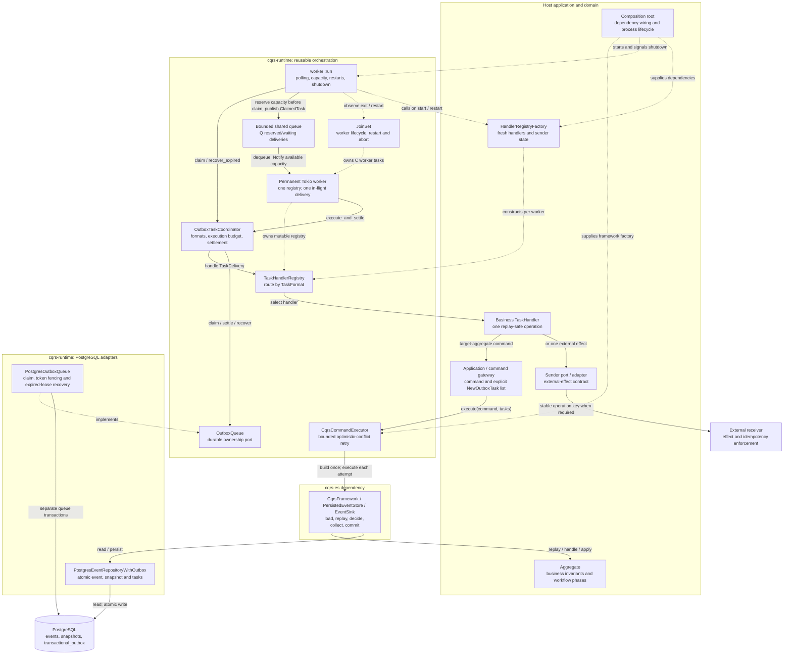
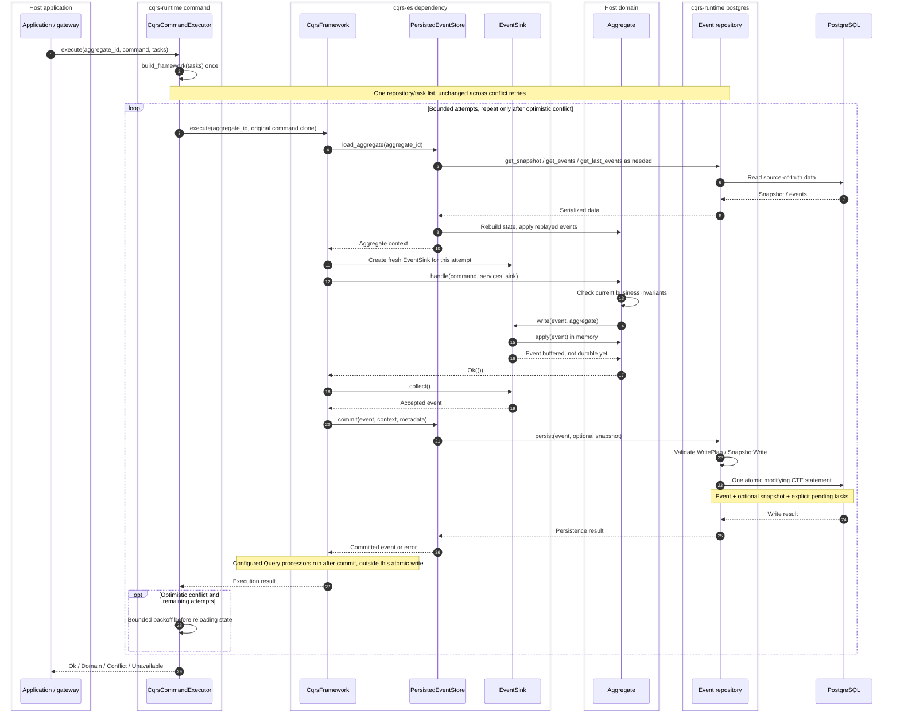

# Architecture and call flow

The diagrams describe the PostgreSQL integration with the `worker` feature.
`cqrs-es` supplies the framework and event store; the host supplies aggregates,
gateways, handlers, senders, configuration, and process lifecycle.
For the complete delivery, retry, and timeout contract, see
[Task processing](task_processing.md).

## Components and responsibility boundaries

Solid arrows show calls/data flow; dotted arrows show construction, ownership,
or implementation of a port. A source or target gateway delegates to the same
generic executor; the runtime contains no application-domain dependencies.



The two database writers have different jobs: the event repository publishes
work with an accepted event, while the queue manages delivery ownership.
Neither worker state nor task settlement advances an aggregate's business phase.

## Command execution and atomic publication

This is the accepted, single-event path. Task data is prepared by application
before execution; it is not generated by the worker or inferred from event
metadata. The framework factory binds the immutable list to a new repository
once per command invocation.



A domain rejection stops before `commit`. The adapter rejects multi-event,
snapshot-only, or tasks-without-event writes before SQL; an empty write with
no snapshot/tasks is a no-op. A rolled-back write publishes nothing, but a lost
response can hide a successful commit. Only optimistic conflicts receive fast
retries. Tasks become visible at database commit, not at the client response
or completion of any configured projection.

The queue's storage deadline and transaction-local PostgreSQL statement timeout
do **not** automatically apply to event-store reads/writes on the shared pool.

## Claim, execute, settle and release capacity

The supervisor shares one coordinator; each permanent Tokio worker owns a registry.
The diagram shows reserved queue capacity followed by one claimed task; other workers and
tasks can run concurrently, including tasks from the same aggregate.

```mermaid
sequenceDiagram
    autonumber
    box cqrs-runtime worker
        participant Supervisor as Supervisor
        participant Channel as Bounded channel
        participant Slot as Permanent Tokio worker
    end
    box cqrs-runtime outbox
        participant Coordinator as Coordinator
        participant Registry as Worker registry
    end
    box cqrs-runtime postgres
        participant Queue as Queue adapter
    end
    participant DB as PostgreSQL
    box Host application
        participant Handler as Business handler
        participant Operation as Sender / target gateway
    end
    participant Receiver as External receiver

    Note over Supervisor,Registry: Startup: validate lease budget, factory builds and validates each registry
    Note over Supervisor,Slot: JoinSet observes exits; replace one worker with a fresh checked registry
    Supervisor->>Supervisor: Polling tick
    Supervisor->>Coordinator: recover_expired(min(worker count, 32))
    Coordinator->>Queue: recover_expired(limit), bounded storage await
    Queue->>DB: Transaction: lock expired rows, retry or fail, invalidate tokens, COMMIT
    DB-->>Queue: Confirmed transitions
    Queue-->>Coordinator: LeaseRecoveryReport
    Coordinator-->>Supervisor: Recovery report, log confirmed failures

    Supervisor->>Channel: Reserve free permits (includes claim batch)
    Supervisor->>Coordinator: claim(owner, reserved capacity, lease duration)
    loop Supported formats, one shared claim deadline
        Coordinator->>Queue: claim(format, owner, remaining capacity, lease)
        Queue->>Queue: Anchor local lease deadline BEFORE pool acquisition
        Queue->>DB: Transaction: SKIP LOCKED claim, attempts += 1, fresh token, COMMIT
        DB-->>Queue: Claimed rows / commit acknowledgement
        Queue-->>Coordinator: ClaimedTask batch with original local deadlines
    end
    Coordinator-->>Supervisor: Confirmed tasks, including any earlier partial batch
    Supervisor->>Channel: Publish ClaimedTask through permits
    Slot->>Channel: Dequeue one task; release receiver mutex
    Slot-->>Supervisor: Notify queue capacity available
    Note over Slot,Coordinator: ClaimedTask contains TaskDelivery + ClaimLease
    Slot->>Coordinator: execute_and_settle(registry, task, handler_timeout)
    Coordinator->>Coordinator: Calculate ExecutionPlan from remaining lease

    alt Run or RetryOnly
        alt Run: full handler and settlement budgets fit
            Coordinator->>Registry: handle(task.delivery())
            Registry->>Handler: Route by type/version, handle(TaskDelivery)
            Note over Registry,Handler: No lock token or lease deadline crosses this boundary
            Handler->>Operation: One replay-safe operation, with bounded local retries
            alt Target-aggregate command
                Operation->>Operation: Follow the command publication path above
            else External effect
                Operation->>Receiver: Send with the stable operation key when required
                Receiver-->>Operation: Receiver result
            end
            Operation-->>Handler: Operation result
            Handler-->>Registry: Ok / Retry / Permanent
            Registry-->>Coordinator: Handler result
            Coordinator->>Coordinator: Classify SettlementRequest
            Note over Coordinator,Receiver: Handler timeout requests retry, accepted remote work may still finish
        else RetryOnly: invocation budget no longer fits
            Coordinator->>Coordinator: Request retry without calling handler
        end
        Coordinator->>Queue: settle(ClaimedTask, SettlementRequest), bounded by storage AND remaining lease
        Queue->>DB: Transaction: conditional token/expiry UPDATE, COMMIT
        DB-->>Queue: Changed status or no owned row
        Queue-->>Coordinator: SettlementResult after commit
        Coordinator-->>Slot: Completed / RetryScheduled / Failed / OwnershipLost
    else RecoverOnly: no safe settlement window
        Coordinator-->>Slot: LeaseBudgetExhausted, no handler or settlement
    end

    Slot->>Slot: Continue with same mutable registry; dequeue next task
```

Dequeue frees waiting capacity; finishing execution allows that permanent worker
to dequeue again. Settlement errors do not mark a task completed. A storage timeout
returns `OutboxError::TimedOut` with an unknown database outcome. Panic terminates
a worker; JoinSet reports the exit, the supervisor creates one replacement, and
expired ownership remains for durable recovery. Storage awaits remain bounded.

Queue transactions apply their own statement timeout; the coordinator bounds
the entire await, including pool acquisition and commit. The local lease estimate
never replaces PostgreSQL token/expiry fencing. A retry request may become
`Failed` at the attempt limit. Unknown formats remain pending.

Shutdown and restart-factory failure stop claims and dequeue, then drain started
invocations plus settlement for H+S. Waiting claims remain for recovery; remaining
workers are aborted and joined after the deadline.
Interrupted work remains durable for expiry recovery. There is no lease renewal.

A target command may atomically publish a successor task through the command
path above. That successor can run before the original task's settlement.
External success likewise precedes acknowledgement: redelivery can repeat the
effect, so its idempotency belongs to the handler/receiver, not to queue fencing.

## Source map

- [command](../src/command.rs): executor and optimistic-conflict policy.
- [outbox](../src/outbox.rs): delivery/lease types, registry, queue contracts,
  execution budgets, settlement requests/results.
- [worker](../src/worker.rs): configuration, bounded admission, JoinSet supervision and permanent worker lifecycle.
- [postgres](../src/postgres.rs): event repository, queue and canonical SQL assets.
