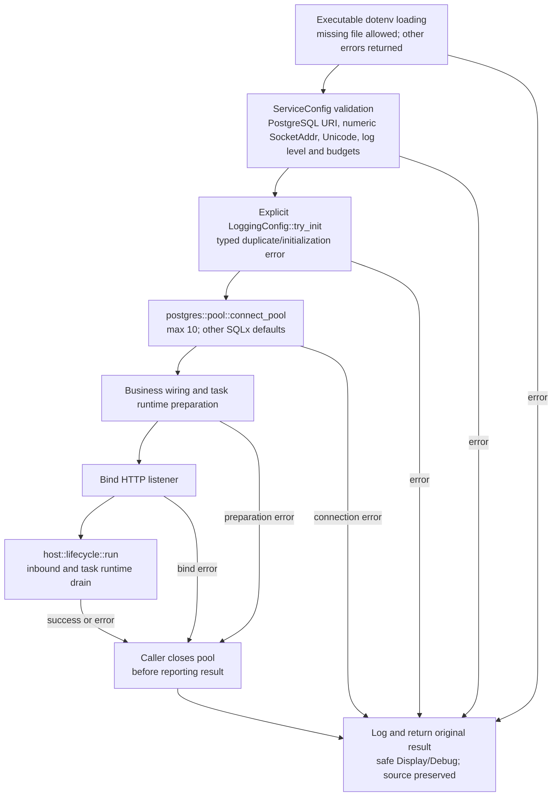
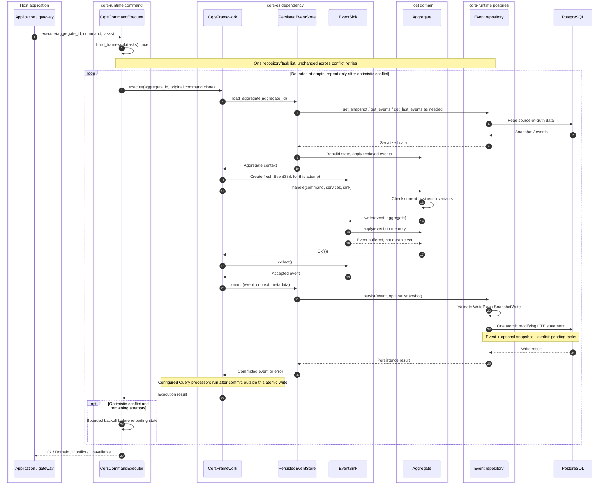

# Architecture and call flow

The diagrams describe the PostgreSQL integration with the `worker` feature.
`cqrs-es` supplies the framework and event store; the host supplies aggregates,
gateways, handlers, senders, configuration, and inbound adapters. The optional
`host` feature owns process lifecycle without depending on an HTTP framework.
Optional `logging` configures only the process logger; base tracing emits safe
diagnostics without installing a subscriber.
For the role tree, see [Components and terminology](components.md).
For the complete delivery, retry, and timeout contract, see
[Task processing](task_processing.md).

## Components and responsibility boundaries

Solid arrows show calls/data flow; dotted arrows show construction, ownership,
or implementation of a port. A source or target gateway delegates to the same
generic executor; the runtime contains no application-domain dependencies.

```mermaid
flowchart TB
    subgraph Host["Host application and domain"]
        Root["Composition root<br/>checked startup, business wiring and pool cleanup"]
        Config["ServiceConfig / ServiceError<br/>URI, numeric bind, logger and budgets; redacted sources"]
        Http["HTTP server<br/>graceful shutdown"]
        Stop["CancellationToken<br/>shared process stop request"]
        Gateway["Application / command gateway<br/>command and explicit NewTask list"]
        Aggregate["Aggregate<br/>business invariants and workflow phases"]
        Factory["TaskDispatcherFactory<br/>fresh handlers and sender state"]
        Handler["Business TaskHandler&lt;P&gt;<br/>one replay-safe operation"]
        Sender["Sender port / adapter<br/>external-effect contract"]
    end

    subgraph Runtime["cqrs-runtime: reusable orchestration"]
        Logger["logging::LoggingConfig<br/>explicit fallible fmt initialization"]
        Lifecycle["host::lifecycle::run / shutdown_signal<br/>signal, cancellation and adapter drain"]
        Executor["CqrsCommandExecutor<br/>bounded optimistic-conflict retry"]
        Preparation["runtime::preparation::prepare / TaskRuntime<br/>all C dispatchers checked before HTTP"]
        Supervisor["TaskRuntime.run / runtime::supervisor::run<br/>shared polling, restarts, shutdown"]
        Channel["DispatchBuffer / bounded async-channel<br/>Q waiting deliveries"]
        Slot["Permanent Tokio worker<br/>one dispatcher; one in-flight delivery"]
        JoinSet["JoinSet<br/>worker lifecycle, restart and abort"]
        Poller["Private Poller<br/>rotating claims, recovery, storage budget"]
        AttemptExecutor["TaskExecutor<br/>one attempt: execution budget and settlement"]
        Dispatcher["TaskDispatcher<br/>route by TaskFormat"]
        TypedAdapter["task_adapter<br/>checked format and owned DTO decode"]
        QueuePort["TaskQueue<br/>durable ownership port"]
    end

    subgraph Framework["cqrs-es dependency"]
        Cqrs["CqrsFramework / PersistedEventStore / EventSink<br/>load, replay, decide, collect, commit"]
    end

    subgraph Adapters["cqrs-runtime: PostgreSQL adapters"]
        Pool["postgres::pool::connect_pool<br/>ten connections; original SQLx errors"]
        CommandFactory["postgres::command_factory::command_executor<br/>checked snapshot and retry configuration"]
        Repository["PostgresEventRepositoryWithOutbox<br/>atomic event, snapshot and tasks"]
        Queue["PostgresTaskQueue<br/>claim, token fencing and expired-lease recovery"]
    end

    Database[("PostgreSQL<br/>events, snapshots, transactional_outbox")]
    Receiver["External receiver<br/>effect and idempotency enforcement"]

    Root -.->|"dotenv then validate before DB"| Config
    Root -.->|"explicit init after config"| Logger
    Root -.->|"checked PgConnectOptions"| Pool
    Pool -->|"connect"| Database
    Root -.->|"pool and PostgresCommandConfig"| CommandFactory
    CommandFactory -.->|"constructs CommandExecutor"| Executor
    Root -.->|"prepare before binding HTTP"| Preparation
    Preparation -.->|"owns checked handlers; run consumes"| Supervisor
    Root -.->|"creates shared token"| Stop
    Root -.->|"starts"| Lifecycle
    Root -.->|"constructs"| Http
    Lifecycle -.->|"first poll: spawn task runtime"| Supervisor
    Lifecycle -.->|"await before pool cleanup"| Http
    Lifecycle -.->|"await independent H+S drain"| Supervisor
    Lifecycle -.->|"signal or critical component exit: cancel"| Stop
    Supervisor -.->|"fatal error: cancel before drain"| Stop
    Stop -.->|"stop HTTP admission"| Http
    Stop -.->|"stop claims and recovery"| Supervisor
    Stop -.->|"stop dequeue; preserve active invocation"| Slot
    Root -.->|"supplies dependencies"| Factory
    Gateway -->|"CommandExecutor: execute(id, command, tasks)"| Executor
    Executor -->|"build once; execute each attempt"| Cqrs
    Cqrs -->|"replay / handle / apply"| Aggregate
    Cqrs -->|"read / persist"| Repository
    Repository -->|"read; atomic write"| Database

    Supervisor -->|"claim / recover_expired"| Poller
    Supervisor -->|"snapshot free buffer capacity before claim; publish LeasedTask"| Channel
    Channel -->|"dequeue; Notify available capacity"| Slot
    Supervisor -.->|"observe exit / restart"| JoinSet
    JoinSet -.->|"owns C worker tasks"| Slot
    Preparation -.->|"calls C times before admission"| Factory
    Supervisor -.->|"calls on restart"| Factory
    Factory -.->|"constructs per worker"| Dispatcher
    Slot -.->|"owns mutable dispatcher"| Dispatcher
    Slot -->|"execute_and_settle"| AttemptExecutor
    AttemptExecutor -->|"dispatch TaskAttempt"| Dispatcher
    Dispatcher -->|"select single-version adapter"| TypedAdapter
    TypedAdapter -->|"owned DTO and original TaskAttempt"| Handler
    Dispatcher -->|"custom multi-version TaskAdapter"| Handler
    Handler -->|"target-aggregate command"| Gateway
    Handler -->|"or one external effect with borrowed TaskAttempt"| Sender
    Sender -->|"stable operation key when required"| Receiver
    Poller -->|"claim / recover_expired"| QueuePort
    AttemptExecutor -->|"settle"| QueuePort
    Queue -.->|"implements"| QueuePort
    Queue -->|"separate queue transactions"| Database
```



The base typed adapter owns checked format registration and JSON decoding.
Application owns versioned DTOs, semantic validation and business outcome
classification. One adapter per DTO version joins the existing dispatcher; custom
multi-version `TaskAdapter` implementations remain supported. Format/decode
failures never call business code, and expose only sanitized expected type/version.
The application verification sender borrows the original `TaskAttempt`; context
metadata is not cloned for delivery. See the
[typed task adapter plan](../../doc/backlog/cqrs_runtime_typed_task_adapter.md).

`TaskRuntimeConfig` checks storage/worker budgets at construction or env
load time. PostgreSQL statement timeout remains adapter configuration.
`prepare_task_runtime` constructs the queue and delegates to `runtime::preparation::prepare`,
without SQL or background tasks. Exactly C dispatchers are retained, including the
first used for ordered format discovery. Errors/drop release prepared handlers;
no cancellation token exists in the prepared object. A polled run binds the host's
token with DropGuard. Low-level run retains custom executor support and uses
this same execution engine.

The two database writers have different jobs: the event repository publishes
work with an accepted event, while the queue manages delivery ownership.
Neither worker state nor task settlement advances an aggregate's business phase.

## Startup and caller-owned cleanup



Private binary config/startup modules own settings and pool cleanup; host still
owns component lifecycle. Startup error reporting never formats raw dotenv lines,
connection options, URL/password or arbitrary SQLx/I/O causes. Native SQLx PG option
behavior is preserved. Normal await closes pool on preparation/bind/host errors;
Drop/abort cannot guarantee cleanup. No pool or host deadline is added. See the
[startup plan](../../doc/backlog/cqrs_runtime_configuration_logging.md).

The executor logs terminal technical command errors before mapping to Unavailable,
with execute operation and sanitized aggregate type. SQLx sources are inspected
without their Display/Debug; queue errors log safe category and operation before
the source is erased. Only valid SQLSTATE is emitted. Domain/conflict behavior,
retry ownership and database mappings remain unchanged.

## Command execution and atomic publication

This is the accepted, single-event path. Task data is prepared by application
before execution; it is not generated by the worker or inferred from event
metadata. The framework factory binds the immutable list to a new repository
once per command invocation.

The host assembles the standard executor with `postgres::command_factory::command_executor`;
construction performs no I/O. `PostgresCommandConfig` defaults to snapshots every
25 events and the existing conflict retry policy. The standard path uses unit
services and no queries. Custom stores/services/queries remain supported through
`CqrsCommandExecutor::new`; both paths implement the same `CommandExecutor<A>`
technical boundary. Service gateways own aggregate-ID selection, not framework
construction. The current upstream snapshot path requires repeat-tolerant `apply`
([known issue](../../doc/known_issues/cqrs_snapshot_event_reapplication.md)).



A domain rejection stops before `commit`. The adapter rejects multi-event,
snapshot-only, or tasks-without-event writes before SQL; an empty write with
no snapshot/tasks is a no-op. A rolled-back write publishes nothing, but a lost
response can hide a successful commit. Only optimistic conflicts receive fast
retries. Tasks become visible at database commit, not at the client response
or completion of any configured projection.

The task storage deadline and transaction-local PostgreSQL statement timeout
do **not** automatically apply to event-store reads/writes on the shared pool.

## Claim, execute, settle and release capacity

The supervisor owns a private poller and shares one executor; each permanent Tokio worker owns a dispatcher.
The diagram shows a free-capacity snapshot followed by one claimed task; other workers and
tasks can run concurrently, including tasks from the same aggregate.

```mermaid
sequenceDiagram
    autonumber
    box cqrs-runtime runtime
        participant Supervisor as Supervisor
        participant Poller as Poller
        participant Channel as Bounded channel
        participant Slot as Permanent Tokio worker
    end
    box cqrs-runtime task
        participant AttemptExecutor as TaskExecutor
        participant Dispatcher as Worker dispatcher
        participant TypedAdapter as Typed task adapter
    end
    box cqrs-runtime postgres
        participant Queue as Queue adapter
    end
    participant DB as PostgreSQL
    box Host application
        participant Handler as Business handler
        participant Operation as Sender / target gateway
    end
    participant Receiver as External receiver

    Note over Supervisor,Dispatcher: Before HTTP: combined config validates budget; prepare builds C dispatchers
    Note over Supervisor,Dispatcher: run uses those same dispatchers; low-level run shares the engine
    Note over Supervisor,Slot: JoinSet observes exits; replace one worker with a fresh checked dispatcher
    Supervisor->>Supervisor: Polling tick
    Supervisor->>Poller: recover_expired(min(worker count, 32))
    Poller->>Queue: recover_expired(limit), bounded storage await
    Queue->>DB: Transaction: lock expired rows, retry or fail, invalidate tokens, COMMIT
    DB-->>Queue: Confirmed transitions
    Queue-->>Poller: LeaseRecoveryReport
    Poller-->>Supervisor: Recovery report, log confirmed failures

    Supervisor->>Channel: Snapshot free capacity Q - sender.len()
    Supervisor->>Poller: claim(owner, Q - sender.len(), lease duration)
    loop Supported formats, one shared claim deadline
        Poller->>Queue: claim(format, owner, remaining capacity, lease)
        Queue->>Queue: Anchor local lease deadline BEFORE pool acquisition
        Queue->>DB: Transaction: SKIP LOCKED claim, attempts += 1, fresh token, COMMIT
        DB-->>Queue: Claimed rows / commit acknowledgement
        Queue-->>Poller: LeasedTask batch with original local deadlines
    end
    Poller-->>Supervisor: Confirmed tasks, including any earlier partial batch
    Supervisor->>Channel: try_send each LeasedTask, sole producer
    Slot->>Channel: recv through worker's cloned receiver
    Slot-->>Supervisor: Notify queue capacity available
    Note over Slot,AttemptExecutor: LeasedTask contains TaskAttempt + TaskLease
    Slot->>AttemptExecutor: execute_and_settle(dispatcher, task, handler_timeout)
    AttemptExecutor->>AttemptExecutor: Calculate ExecutionPlan from remaining lease

    alt Run or RetryOnly
        alt Run: full handler and settlement budgets fit
            AttemptExecutor->>Dispatcher: dispatch(task.attempt())
            Dispatcher->>TypedAdapter: Route by type/version, invoke(TaskAttempt)
            TypedAdapter->>TypedAdapter: Compare format, decode owned DTO from borrowed JSON
            Note over TypedAdapter,Handler: No lock token or lease deadline crosses this boundary
            alt Invalid format or DTO schema
                TypedAdapter-->>Dispatcher: Permanent with safe expected type/version
            else Valid DTO
                TypedAdapter->>Handler: handle(owned DTO, original TaskAttempt)
                Handler->>Operation: One replay-safe operation; sender borrows TaskAttempt
                alt Target-aggregate command
                    Operation->>Operation: Follow the command publication path above
                else External effect
                    Operation->>Receiver: Send with the stable operation key when required
                    Receiver-->>Operation: Receiver result
                end
                Operation-->>Handler: Operation result
                Handler-->>TypedAdapter: Ok / Retry / Permanent
                TypedAdapter-->>Dispatcher: Business result unchanged
            end
            Dispatcher-->>AttemptExecutor: Handler result
            AttemptExecutor->>AttemptExecutor: Classify SettlementRequest
            Note over AttemptExecutor,Receiver: Handler timeout requests retry, accepted remote work may still finish
        else RetryOnly: invocation budget no longer fits
            AttemptExecutor->>AttemptExecutor: Request retry without calling handler
        end
        AttemptExecutor->>Queue: settle(LeasedTask, SettlementRequest), bounded by storage AND remaining lease
        Queue->>DB: Transaction: conditional token/expiry UPDATE, COMMIT
        DB-->>Queue: Changed status or no owned row
        Queue-->>AttemptExecutor: SettlementResult after commit
        AttemptExecutor-->>Slot: Completed / RetryScheduled / Failed / OwnershipLost
    else RecoverOnly: no safe settlement window
        AttemptExecutor-->>Slot: LeaseBudgetExhausted, no handler or settlement
    end

    Slot->>Slot: Continue with same mutable dispatcher; dequeue next task
```

Dequeue frees waiting capacity; finishing execution allows that permanent worker
to dequeue again. Settlement errors do not mark a task completed. A storage timeout
returns `TaskProcessingError::TimedOut` with an unknown database outcome. Panic terminates
a worker; JoinSet reports the exit, the supervisor creates one replacement, and
expired ownership remains for durable recovery. Storage awaits remain bounded.

Queue transactions apply their own statement timeout; the executor bounds
the entire await, including pool acquisition and commit. The local lease estimate
never replaces PostgreSQL token/expiry fencing. A retry request may become
`Failed` at the attempt limit. Unknown formats remain pending.

Shutdown cancels the shared CancellationToken before closing the channel and
stops claims and dequeue, then drains started invocations plus settlement for H+S.
Startup/restart errors cancel that token before returning/draining: HTTP begins
graceful shutdown while healthy workers still finish. A worker panic is restarted
without cancelling the process. Waiting claims remain for recovery; remaining
workers are aborted and joined after the deadline. The supervisor's DropGuard also
requests host cancellation on panic/abort, when asynchronous drain is impossible.

The host awaits HTTP and task runtime before closing PostgreSQL, preserving the primary
failure and logging secondary errors with safe task diagnostics. HTTP can publish
new durable tasks while its in-flight requests finish; these tasks wait for a
subsequent healthy pool. HTTP/DB cleanup has no overall deadline yet
([known issue #10](../../doc/known_issues/http_shutdown.md)); the synchronous
stdout adapter can exceed cooperative async budgets (backlog task #11).
Interrupted work remains durable for expiry recovery. There is no lease renewal.

A target command may atomically publish a successor task through the command
path above. That successor can run before the original task's settlement.
External success likewise precedes acknowledgement: redelivery can repeat the
effect, so its idempotency belongs to the handler/receiver, not to queue fencing.

## Source map

- [command](../src/command.rs): executor and optimistic-conflict policy.
- [task](../src/task.rs): data, handling, queue and executor namespaces;
  import public contracts directly from their defining modules. Handler-visible
  attempts are separate from lease ownership.
- [runtime](../src/runtime.rs): combined configuration, synchronous preparation,
  checked dispatcher construction, bounded admission, worker-pool ownership and
  permanent worker lifecycle.
- [postgres](../src/postgres.rs): event repository, queue and canonical SQL assets.
  Each queue operation owns its complete transaction; the repository adapter,
  checked write plan and atomic SQL compiler have separate implementation files.
- [host](../src/host.rs): signal observation, shared cancellation and inbound/task-runtime lifecycle.
- [logging](../src/logging.rs): explicit process logger configuration and fallible installation.

See the [component source layout](components.md#source-layout) for the concrete
directories and the unit/integration test boundaries.

`host::lifecycle::run` installs a cancellation guard before task runtime spawn on first poll.
Inbound and signal futures execute within host without `Send`/`'static` bounds.
Normal return waits for both components, then the composition root closes the
pool even on error. Host Drop/abort cancels the token and detaches task runtime for
independent drain on a live Tokio runtime; it drops inbound and cannot guarantee
cleanup. No host timeout or watchdog is added. See the
[host lifecycle implementation plan](../../doc/backlog/cqrs_runtime_host_lifecycle.md).
