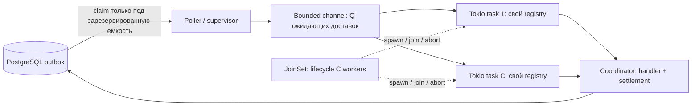

# JoinSet: постоянные workers, bounded queue и конкурентность

Статус: выполнено. fmt, Clippy, workspace tests (138 passed) и coverage прошли;
line coverage workspace — 97.83%.
Defaults: C=128, Q=128, lease=120 секунд; C задается на процесс независимо от CPU.
Production runtime использует JoinSet и общий bounded Tokio mpsc channel.

## Требования

1. Отдельно задавать число workers `C` и емкость локальной очереди ожидания `Q`.
2. Каждая постоянная Tokio task владеет своим mutable TaskHandlerRegistry.
   Registry и sender state сохраняются между доставками до выхода/panic worker.
3. Worker выполняет одну доставку от начала handler до окончания settlement,
   прежде чем брать следующую. Не запускать вложенный spawn на каждую доставку.
4. JoinSet отслеживает workers, сообщает об их выходе/panic и предоставляет
   abort; очередь предоставляет backpressure. JoinSet сам не ограничивает
   число вызовов spawn и не является очередью доставок.
5. Задачи, на которые нет локальной емкости, остаются в PostgreSQL.

Согласовано: «bind к Tokio task» означает постоянный worker с
собственным handler registry. Предыдущий вариант с переносом registry в новую
Tokio task на каждую доставку не дает постоянной привязки и здесь не выбран.
Привязка к Tokio task не означает привязку к OS thread: Tokio может перемещать
Send task между потоками. Для thread-affine / !Send handlers нужен отдельный
LocalSet-дизайн, который текущий TaskHandler: Send не предусматривает.

## Проблемы прежней реализации (до рефакторинга)

### Дублирование учета lifecycle

Supervisor хранит Vec<WorkerSlot>, каждый slot содержит JoinHandle и
Idle/Busy/Draining. Еще существуют mailbox на worker и отдельный канал
worker_available. Для освобождения capacity worker отправляет свой index,
а supervisor меняет Busy на Idle. Это рабочий протокол, но его состояние
приходится поддерживать вручную поверх lifecycle Tokio task.

При panic сообщение worker_available не отправляется. Supervisor обнаруживает
завершившийся worker через is_finished на polling tick. До следующего такого
обхода capacity остается занятой; причина panic не извлекается из JoinError.
JoinSet позволяет ожидать завершение worker напрямую через join_next_with_id.
Это убирает зависимость обнаружения от polling tick, но supervisor все еще
должен вернуться из ограниченного storage await к обработке событий.

### Не было независимой настройки очереди

Сейчас есть concurrency и mailbox емкостью 1 на каждый worker. Supervisor
выдает работу только Idle slots, поэтому Busy worker не получает дополнительную
доставку. Независимо настроить общую очередь ожидания нельзя: увеличение
concurrency одновременно увеличивает число handler registry и Tokio workers.

Привязка registry к постоянной Tokio task уже реализована через spawn_worker;
рефакторинг должен сохранить это свойство. Проблема состоит в устройстве
очереди и ручном supervision, а не в отсутствии привязки сейчас.

В предлагаемом дизайне отдельный bounded channel хранит ожидающие доставки,
а C workers определяют число одновременно выполняемых доставок.

### Разные пути остановки

Обычный shutdown закрывает mailboxes и дает работникам время завершить работу.
Ошибка factory при restart выходит через `?` и приводит к abort остальных
WorkerSlot через Drop без этой процедуры drain. Новая реализация должна
явно согласовать выходы с задачей 2 из backlog.

## Реализованная схема



Одновременно выполняется не больше C доставок, включая settlement; в channel
находится не больше Q ожидающих доставок. Еще есть poller/supervisor и задачи
приложения: C не является глобальным пределом всех Tokio tasks в процессе.
Async I/O может ожидать, но доставка продолжает занимать один worker.

Выбранный и реализованный вариант: tokio::sync::mpsc::channel(Q) и общий Receiver под
tokio::sync::Mutex. Mutex удерживается только во время recv, затем освобождается
до handler и settlement. Получение очередной доставки сериализовано; сами
handler выполняются конкурентно и не делят mutable registry.

Отложенная альтернатива: bounded MPMC async-channel с клонируемыми receivers. Это убирает
Mutex для приема, но добавляет зависимость. Выбирать по читаемости и реальной
нагрузке, не вводить свой MPMC channel. broadcast непригоден: одну доставку
должен получить один worker.

Для обоих bounded channel нужна положительная емкость. Режим Q=0 («совсем без
prefetch») потребует другого механизма rendezvous/worker readiness; не подменять
его молча channel(1). Настройка max backlog в PostgreSQL — отдельная admission
policy публикации, а не значение Q.

## Пример: C=2, Q=3

В БД готовы A, B, C, D, E, F и G.

| Место | Доставки |
| --- | --- |
| Worker 1 | A: handler/settlement |
| Worker 2 | B: handler/settlement |
| Локальная очередь | C, D, E |
| PostgreSQL pending | F, G |

Завершение A позволяет worker 1 взять C. На освободившееся место в channel
poller может claim F. Увеличение Q с 3 до 10 оставляет два workers и два
registry. Увеличение C с 2 до 4 дает четыре независимых registry и до четырех
конкурентных доставок, сохраняя Q=3.

Если worker 1 паникует на A, JoinSet возвращает JoinError. Supervisor использует
JoinError::id и небольшую map Tokio task ID → worker index, проверяет новый
registry и запускает один replacement worker. A остается для lease recovery;
доставки C/D/E не принадлежали упавшему worker и остаются в общей очереди.
Panic восстанавливается при unwind; panic=abort завершает весь процесс.

## Минимальная демонстрация владения

Фрагмент иллюстрирует владение и конкурентность; это не готовый production
supervisor: здесь опущены polling, reserve перед claim, shutdown и restart.

```rust
let (tx, rx) = tokio::sync::mpsc::channel::<ClaimedTask>(queue_capacity);
let inbox = Arc::new(tokio::sync::Mutex::new(rx));
let mut workers = tokio::task::JoinSet::new();

// Все registries заранее построены и проверены до начала claim.
for (worker_index, mut registry) in registries.into_iter().enumerate() {
    let inbox = inbox.clone();
    let coordinator = coordinator.clone();
    workers.spawn(async move {
        loop {
            let task = {
                let mut rx = inbox.lock().await;
                rx.recv().await
            }; // Mutex освобожден до выполнения операции.
            let Some(task) = task else { break };
            let result = coordinator
                .execute_and_settle(&mut registry, task, handler_timeout)
                .await;
            report_settlement(result);
        }
        worker_index
    });
}
```

C — число запущенных worker loops, Q — емкость channel. Предел конкурентности
обеспечивает фиксированное число loops с последовательной обработкой.
Semaphore дополнительно не нужен, пока нет других путей запуска handlers.
JoinSet::len показывает число tracked workers, включая завершенные, результаты
которых еще не извлечены; это не счетчик выполняемых handler invocations.

## Claim и backpressure

- Единственный poller резервирует свободные channel slots ДО обращения к БД:
  через try_reserve_many; ожидание claim отменяется при shutdown.
- Claim limit не превышает число зарезервированных slots. Если места нет,
  новые задачи не переводятся в processing.
- Подтвержденные задачи публикуются через полученные permits; не добавлять
  скрытый VecDeque или новую Tokio task, ожидающую send, поверх полного channel.
- Резервация на время claim тоже потребляет локальную емкость. Claim batch и
  channel вместе не должны обходить Q; недоиспользованные permits освобождаются.
- Извлечение доставки worker освобождает место в channel; после этого она
  занимает один из C execution slots до окончания settlement.
- Сохранять partial multi-format claim results и неизвестный результат timeout.
  Shutdown при claim может оставлять неизвестную ownership для durable recovery.
- Эти пределы относятся к известным локально доставкам. При неизвестном
  результате claim в БД могут остаться дополнительные processing rows;
  ограничение Q+C не является глобальным пределом processing rows в storage.
- Коалесцируемое уведомление о появлении места может ускорить refill. Оно не
  хранит Busy/Idle workers и не является подтверждением бизнес-успеха.

## Очередь и lease budget

Локальная очередь содержит уже claimed задачи: lease идет во время ожидания.
Q нельзя бездумно увеличивать только ради throughput. Текущая startup-формула
не предусматривает очередь из нескольких последовательных волн:

```text
S = storage timeout; H = handler timeout; M = safety margin
прежняя оценка без prefetch: lease > 2*S + H + M
с prefetch:     lease > 2*S + H + M + ceil(Q/C)*(H+S)
```

Вторая формула — консервативная оценка при здоровых C workers и FIFO dequeue.
Она не гарантирует бюджет после panic, длительной паузы runtime или других
сбоев; проверка исходного deadline на каждой доставке остается обязательной.
Реализация использует checked arithmetic и проверяет совместно Q и lease. Defaults C=128/Q=128/lease=120s дают 40s запаса.

Например, C=2, Q=3, H=30s, S=5s, M=5s требуют lease >115s по этой оценке.
С прежними 60s ожидающая доставка может не иметь полного execution budget;
coordinator запросит retry без вызова handler, а claim уже потратит attempt.
Увеличение lease замедляет recovery после падения процесса. Heartbeat или
claim только непосредственно перед выполнением — отдельные варианты дизайна.

Лимит Q ограничивает число элементов, не суммарные байты JSON payloads и не
удаленные эффекты, продолжающиеся после локального timeout.

## Shutdown

Предпочтительная политика: остановить claim и получение новых доставок;
workers завершают уже начатые handler + settlement. Ожидающие claimed задачи
остаются для expiry recovery; их извлечение/удаление из памяти не завершает
их в БД. Не запускать всю очередь после shutdown по инерции.

Сигнал остановки проверять до recv и после получения доставки, но не отменять
уже начатый execute_and_settle при обычном graceful shutdown. Supervisor дает
общий deadline H+S, затем вызывает abort_all и извлекает join results.
JoinSet::shutdown сразу abort-ит workers; это этап принудительной остановки,
а не замена drain. Если потребуется drain всей очереди, это отдельная политика
с отдельным бюджетом, зависящим от Q/C.

## Критерии приемки реализации

- C и Q независимо валидируются и документируются; новые env settings есть
  в .env.example, runtime guide и rustdoc.
- Все registries проверяются до первого claim; restart проверяет formats.
- Ни при backlog, ни при storage stall/panic не выполняется больше C доставок.
- При полной очереди нет новых claims; reserved slots и claim batches не
  создают скрытый дополнительный буфер сверх Q.
- Две доставки одного worker используют один registry и один Tokio task ID;
  replacement после panic получает новый registry/task ID.
- JoinSet обнаруживает panic без ожидания polling tick; replacement не
  увеличивает размер пула сверх C.
- Сохраняются tests на partial claims, storage timeout после commit, original
  lease deadline, lease fencing, retry и safe failure logging.
- Shutdown и ошибочный выход supervisor имеют явную политику drain; после
  принудительной остановки остаются только durable задачи для recovery.
- Обязательные fmt, clippy, workspace tests и coverage >=90% проходят.

## Источники

- [Tokio JoinSet 1.53.1](https://docs.rs/tokio/1.53.1/tokio/task/struct.JoinSet.html).
- [Tokio bounded mpsc Sender: capacity и reserve](https://docs.rs/tokio/latest/tokio/sync/mpsc/struct.Sender.html).
- [Tokio mpsc Receiver](https://docs.rs/tokio/latest/tokio/sync/mpsc/struct.Receiver.html).
- [async-channel: bounded MPMC](https://docs.rs/async-channel/latest/async_channel/).
- [Текущий runtime contract](../../cqrs-runtime/doc/task_processing.md).

## Итог реализации

Supervisor использует JoinSet и map Tokio task ID → worker index, единый channel
и try_reserve_many перед claim. Worker сохраняет registry между доставками;
Notify после dequeue запускает refill. Recovery limit — min(C, 32).
Один internal watch останавливает dequeue перед drain как при host shutdown,
так и при restart-factory error. По истечении H+S workers abort-ятся и join-ятся.
Отмена самого supervisor не оставляет detached workers.

Явный constructor: `OutboxWorkerPoolConfig::new(C, Q, poll_interval,
handler_timeout, lease_duration)`. Defaults/env overrides независимы;
нулевая или неподдерживаемая емкость отвергается typed error. Startup отвергает
недостаточный lease, сохраняя исходные per-delivery deadlines.

Тесты проверяют independent C/Q, полный channel без claims, shutdown с ожидающими
задачами, постоянные registry/task IDs, replacement после panic без polling tick,
restart error drain, forced abort/join и cancellation supervisor. Проверка
1000 I/O workers на одном runtime thread моделирует ожидание через Semaphore;
она не измеряет производительность HTTP, PostgreSQL или connection pools.
