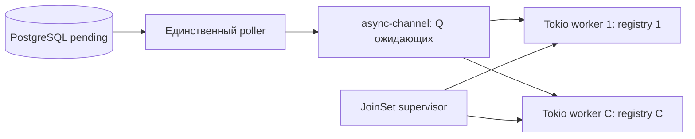

# JoinSet, async-channel и независимые ограничения C/Q

Статус: реализовано. Defaults: C=128, Q=128, lease=120 секунд.
Runtime использует одну bounded async-channel 2.5.0 очередь и JoinSet постоянных
Tokio workers. Старые реализации очереди и сравнительные бенчмарки удалены.

## Владение и конкурентность

Каждый worker — постоянная Tokio task с собственным mutable TaskHandlerRegistry
и клоном Receiver. Registry и состояние обработчиков сохраняются между доставками.
Worker выполняет одну доставку целиком, включая settlement, затем берет следующую.
Внешний mutex для приема и вложенный spawn на каждую доставку не нужны.

JoinSet отслеживает завершение, panic и abort. Supervisor хранит map Tokio task ID
→ worker index и запускает один replacement с заново проверенным registry.
Это устраняет ручной учет Busy/Idle поверх task lifecycle и обнаружение panic
только по polling tick. In-progress storage await может задержать обработку выхода.
Не логировать panic payload; panic=abort завершает весь процесс.

C ограничивает число конкурентных доставок, Q — число ожидающих в локальной
очереди. Оба параметра независимы от числа CPU и runtime threads.
Привязка registry к Tokio task не означает привязку к OS thread.



Например, при C=2/Q=3 доставки A/B выполняются, C/D/E ждут в очереди,
а F/G остаются pending в PostgreSQL. После завершения A worker берет C;
poller может claim F на освободившееся место. Увеличение Q не добавляет
workers; увеличение C добавляет независимые registry и Tokio tasks.

## Claim и backpressure

- Sender принадлежит только poller. Перед claim он вычисляет `limit = Q - sender.len()`.
  При нуле новый claim не выполняется.
- Во время claim consumers могут только освобождать очередь. Поэтому batch не
  больше limit гарантированно помещается через try_send без резервирования permits.
  Pending batch вместе с текущим содержимым очереди не превышает Q.
- Не добавлять вторую очередь, фоновые send tasks или другие producers без нового
  admission-протокола. Ошибка try_send — нарушение внутреннего инварианта; ее Debug
  содержит ClaimedTask и не должен попадать в логи или panic text.
- Dequeue отправляет coalesced Notify для refill. Polling interval остается fallback;
  recovery ограничен min(C, 32). Notify и worker exits не отменяют текущий claim.
- Partial multi-format results сохраняются. Неизвестный результат storage timeout
  может оставить дополнительные processing rows; C+Q ограничивает известные
  локальные доставки, а не все processing rows в PostgreSQL.
- Отмена pending recv после уведомления не расходует сообщение: другой receiver
  получает ту же доставку с исходными token и monotonic deadline.

Минимальный пример владения, без polling, shutdown и settlement logging:

```rust
let (sender, receiver) = async_channel::bounded::<ClaimedTask>(queue_capacity);
let mut workers = tokio::task::JoinSet::new();
for (index, mut registry) in registries.into_iter().enumerate() {
    let receiver = receiver.clone();
    let coordinator = coordinator.clone();
    workers.spawn(async move {
        while let Ok(task) = receiver.recv().await {
            let result = coordinator
                .execute_and_settle(&mut registry, task, handler_timeout)
                .await;
            report_settlement(result);
        }
        index
    });
}
```

## Lease и shutdown

Startup проверяет с checked arithmetic:
`lease > 2*S + H + 5s + ceil(Q/C)*(H+S)`.
Для C=128/Q=128/H=30s/S=5s требуется lease >80s; для C=2/Q=3 — >115s.
Defaults lease=120s. Увеличение очереди требует большего lease или конкурентности.
Оригинальный deadline проверяется coordinator и остается неизменным после dispatch.

True host shutdown, закрытие host watch или ошибка restart factory запускают
одинаковый drain. Сначала выставляется internal stop, затем закрывается канал:
close сам по себе разрешает чтение buffered сообщений. Worker проверяет stop
с приоритетом перед recv и повторно перед handler; false updates игнорируются.
Только начатые handler/settlement завершаются в общем бюджете H+S, затем оставшиеся
workers abort-ятся и join-ятся. Ожидающие claims остаются для lease recovery.
Отмена supervisor abort-ит принадлежащие JoinSet задачи без detached workers.

## Проверки

Проверяются независимые C/Q, отсутствие claims при полной очереди, постоянные
registry/task IDs, replacement после panic, bounded drain и abort/join,
отмена notified recv, освобождение capacity во время pending claim,
а также 1000 ожидающих I/O workers на одном runtime thread.

Публичный constructor сохраняется: `OutboxWorkerPoolConfig::new(C, Q,
poll_interval, handler_timeout, lease_duration)`.
Q=0 отвергается; Q ограничивает количество элементов, не байты payload и не
размер durable backlog. PostgreSQL schema, DTO, fencing и settlement не меняются.

- [Runtime contract](../../cqrs-runtime/doc/task_processing.md).
- [Tokio JoinSet](https://docs.rs/tokio/1.53.1/tokio/task/struct.JoinSet.html).
- [async-channel 2.5.0](https://docs.rs/async-channel/2.5.0/async_channel/).

Perf-harness и его отчеты удалены после выбора очереди. В unit-тесте supervisor
1000 уникальных задач проходят через реальные workers и coordinator с тестовым
storage. Проверяются точные ID вызовов и Completed settlement каждой задачи;
refill работает через Notify при C=16/Q=32. Остановка idle worker проверяется
отдельно, без измерений latency/throughput.
